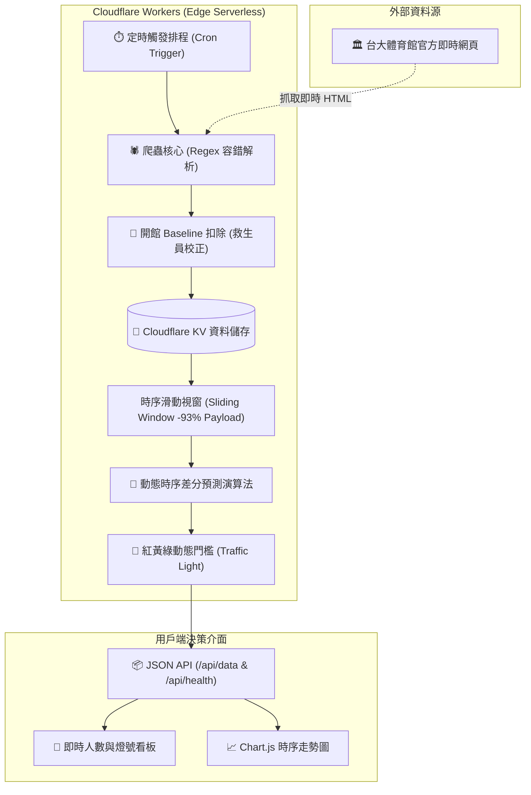

# 🏊 NTU PoolFlow · 台大泳池人流即時監控與智慧預測系統

> **一句話簡介**：針對官方網站「只有單一時間點、缺乏預測性」的痛點，結合 **Cloudflare 邊緣爬蟲**、**動態時序預測演算法** 與 **紅黃綠動態燈號（Traffic Light）**，提供泳客出發當下最佳前往決策的即時看板。

[](https://pool.8915ethan.workers.dev/)
[](https://github.com/8915ethan/ntu-pool/actions/workflows/ci.yml)
[](https://github.com/8915ethan/ntu-pool)
[](https://www.typescriptlang.org/)
[](https://vitest.dev/)
[](LICENSE)

---

## 📸 線上展示 (Live Demo & Preview)

* 🌐 **正式上線網址**：[**https://pool.8915ethan.workers.dev/**](https://pool.8915ethan.workers.dev/)
* 📱 **介面特色**：RWD 響應式佈局、自動深淺色適應、Chart.js 時序走勢圖，支援「真實資料 (BETA)」與「模擬情境 (DEMO)」一鍵切換。

<p align="center">
  
</p>

---

## 🎯 核心痛點與解決方案 (The Problem & Solution)

* **傳統盲點**：官方網站**只有單一時間點**的人數數字，使用者無法得知即將變多還是變少，**缺乏可預測性**。泳客常常出發前看到人少，經歷 15~20 分鐘通勤更衣抵達時，現場卻已因人潮湧入而擁擠爆滿。
* **智慧解法**：除了完整展現**歷史時序資料走勢**，更利用**動態資料即時預測**未來 20 分鐘趨勢，設立不同閾值的**紅黃綠燈號（Traffic Light）**，在人潮急湧時提早亮燈預警，供使用者在當下做出最明智的出行決策。

---

## ⚡ 三大核心特色 (Core Features)

| 核心特色 | 技術實現 | 效益說明 |
| :--- | :--- | :--- |
| **🌐 Cloudflare 邊緣無伺服器爬蟲** | Cron Trigger + Workers + KV | 每 5 分鐘自動輕量採樣官網，邊緣節點零伺服器維護成本，並自動扣除開館救生員底數。 |
| **🔮 動態時序差分演算法預測** | 3:2:1 時間加權變化率 | 提取過去 15 分鐘趨勢推算未來動向，人潮湧入時提前調低警戒門檻，避免泳客到場踩雷。 |
| **🤖 現代化 AI 協同開發實踐** | VS Code + Antigravity + GitHub + Cloudflare | 開發者主導架構與邏輯定義，AI 協同加速型別設計、31 項單元測試覆蓋與自動化 CI/CD 部署。 |

---

## 🏗️ 系統架構 (Architecture)



---

## 📚 深入技術專頁導覽 (Detailed Documentation)

詳細公式推導、架構決策與邊界防禦細節已獨立收錄於分頁：

* 📖 **[深入解析 1：動態人潮斜率加權預測演算法與 7 水道門檻推導](docs/predictive-crowd-offset.md)**  
  *詳細計算公式、時間軸視窗分解、防止過度敏感與極端調整限制機制，以及尖峰急湧與散場情境驗算。*
* ⚖️ **[深入解析 2：技術決策紀錄與架構權衡 (Decision Log & Trade-offs)](docs/decision-log.md)**  
  *收錄爬蟲選型（Regex vs. DOM）、差分時序 vs. 機器學習、開館救生員底數扣除、UTC 跨時區防護與 API 封包瘦身。*

---

## 🌐 相關產品與潛力發展 (Industry Benchmarks & Future Potential)

本專案由個人泳客出發，透過邊緣演算法達成「輕量外部數據感知與人流預測」。在專業運動科技與場館安全領域，已有許多成熟企業發展出高階的智慧水上方案：

* **[煊恩科技 (Xuanen)](https://www.xuanen.com.tw/)**：台灣知名智慧運動場館整合商，專精於泳池水質即時監控、場館人流計數整合與自動化安全控制系統。
* **[Lynxight](https://www.lynxight.com/)**：全球頂尖的 AI 水下視覺即時分析系統，透過現有泳池攝影機結合深度學習，提供 AI 救生防溺預警與泳道密度深度分析。

> 💡 **專案未來演進**：本系統未來可進一步對接中央氣象署天氣 API 提高預測準度；長期若能與專業場館系統（如煊恩或 Lynxight）整合，將能把「大門刷卡總人數」進一步細緻化至「各泳道水下即時密度」，打造全方位的智慧分流看板。

---

## 💻 快速開始 (Quick Start)

```bash
# 1. 複製專案並安裝相依套件
git clone https://github.com/8915ethan/ntu-pool.git
cd ntu-pool
npm install

# 2. 執行全套型別檢查與自動化單元測試
npm run check

# 3. 本機啟動前端看板
npx serve .
# 開啟瀏覽器訪問 http://localhost:3000
```

---

## 📄 授權條款 (License)

本專案採用 [MIT License](LICENSE) 條款開放原始碼。
