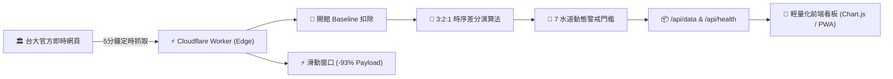

# 🏊 NTU PoolFlow · 台大泳池人流即時監控與智慧預測系統

> **一句話簡介**：消弭「通勤出發到入池的時間落差」，基於 **7 水道物理容量建模**、**3:2:1 時序差分預測** 與 **Cloudflare Workers 邊緣運算** 的台大泳池智慧決策看板。

[](https://pool.8915ethan.workers.dev/)
[](https://github.com/8915ethan/ntu-pool/actions/workflows/ci.yml)
[](https://github.com/8915ethan/ntu-pool)
[](https://www.typescriptlang.org/)
[](https://vitest.dev/)
[](LICENSE)

---

## 📸 線上展示 (Live Demo & Preview)

* 🌐 **正式上線網址**：[**https://pool.8915ethan.workers.dev/**](https://pool.8915ethan.workers.dev/)
* 📱 **介面特色**：RWD 響應式佈局、自動深淺色適應、開館時段自適應圖表，支援切換「真實資料 (BETA)」與「模擬情境 (DEMO)」。

<p align="center">
  
</p>

---

## 🎯 核心痛點與解決方案 (The Problem & Solution)

* **傳統盲點（通勤準備延遲 Transit Delay）**：泳客出發前看到現場舒適（如 30 人綠燈），經 15~20 分鐘通勤更衣抵達後，現場正逢急湧已暴增至 45 人（轉為擁擠紅燈），造成決策落差。
* **智慧解法**：不只呈現當下靜態數值，而是引入**短期時序斜率加權預測**，在急湧時**提前下修紅黃警戒門檻（提早預警）**，讓泳客「在抵達泳池的那一刻依然舒適」。

---

## ⚡ 四大技術亮點 (Technical Highlights)

| 技術特色 | 核心機制 | 實際效益 |
| :--- | :--- | :--- |
| **🏊 7 水道物理容量模型** | 快適 **33 人** / 擁擠 **42 人** | 拒絕憑空設定，依 5 快速長泳道 + 2 慢速道 + 更衣緩衝區推導出人體工學承載上限。 |
| **🔮 3:2:1 時序差分預測** | 提取近 15 分鐘加速度向量 | 越靠近當下權重越高，推算未來 20 分鐘趨勢，動態偏移燈號門檻（防突波限幅 $[-8, +8]$）。 |
| **🎯 開館 Baseline 自動校正** | 開館準備期首筆採樣 | 自動濾除救生員與早班清潔人員常駐底數，忠實還原水下「淨泳客」體驗人數。 |
| **⚡ 邊緣滑動視窗 (Sliding Window)** | API 截取近 14 天活躍時序 | 解決歷史累積 24,000+ 筆資料膨脹瓶頸，**Payload 傳輸量驟降 93%**，首屏秒開。 |

---

## 🏗️ 系統架構 (Architecture)



---

## 📚 深入技術專頁導覽 (Detailed Documentation)

為維持主文件簡潔精煉，完整數學推導、架構決策與邊界防禦細節已獨立收錄於分頁：

* 📖 **[深入解析 1：7 水道物理容量建模與 3:2:1 預測數學推導](docs/predictive-crowd-offset.md)**  
  *詳細推導公式、時間軸視窗分解、阻尼外推抑制機制與 4 種急湧/退潮情境數值驗算。*
* ⚖️ **[深入解析 2：技術決策紀錄與架構權衡 (Decision Log & Trade-offs)](docs/decision-log.md)**  
  *收錄爬蟲選型（Regex vs. DOM）、差分時序 vs. 機器學習、UTC 跨時區冪等化防禦及未來演進 Roadmap。*

---

## 🤖 人機協作標記 (AI Pair Programming)

本專案採用 **AI 結對協作（AI Pair Programming）** 開發模式完成：
* **開發者主導**：實地勘查 50m 標準水道環境、建立 7 水道空間容量數學模型、定義時序衰減預測架構與產品交互決策。
* **AI 協同加速**：輔助 TypeScript 嚴格型別定義、邊界測試案例設計（Vitest 31 項測試覆蓋）、邊緣運算效能調優與 CI/CD 工作流配置。

---

## 💻 快速開始 (Quick Start)

```bash
# 1. 複製專案並安裝相依套件
git clone https://github.com/8915ethan/ntu-pool.git
cd ntu-pool
npm install

# 2. 執行全套型別檢查與自動化單元測試
npm run check

# 3. 本機啟動前端看板
npx serve .
# 開啟瀏覽器訪問 http://localhost:3000
```

---

## 📄 授權條款 (License)

本專案採用 [MIT License](LICENSE) 條款開放原始碼。
