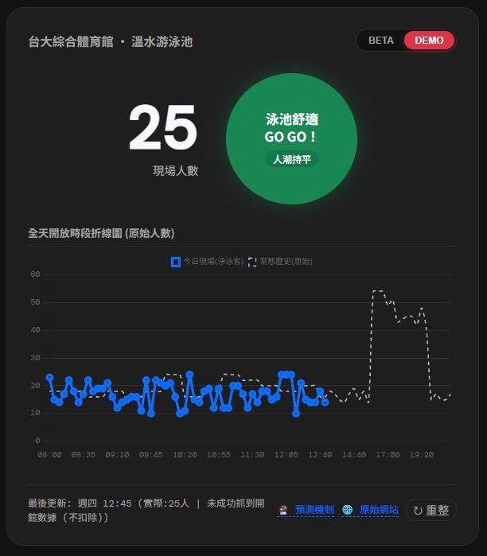
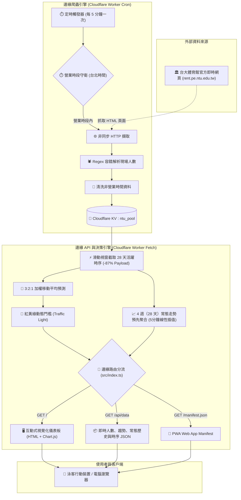

# 🏊 NTU PoolFlow 未游先知
### NTU Sports Center Swimming Pool Real-time Monitor & Edge Serverless Engine

專為國立臺灣大學綜合體育館溫水游泳池設計的輕量級無伺服器（Serverless）邊緣即時監控、時序預測與決策看板系統。

---

## 🚀 線上即時展示 (Live Demo)

* 🌐 **正式上線網址**：[**https://pool.8915ethan.workers.dev/**](https://pool.8915ethan.workers.dev/)

  

---

## 🎯 核心痛點與解決方案 (The Problem & Solution)

* **傳統盲點**：官方網站**只有單一時間點**的人數數字，使用者無法得知即將變多還是變少，**缺乏可預測性**。泳客常常出發前看到人少，經歷約 15 分鐘通勤更衣抵達時，現場卻已因人潮湧入而擁擠爆滿。
* **智慧解法**：除了完整展現**歷史時序資料走勢**，更利用**動態資料即時預測**未來 15 分鐘趨勢，設立不同閾值的**紅黃綠燈號（Traffic Light）**，在人潮急湧時提早亮燈預警，供使用者在當下做出最明智的出行決策。

---

## ⚡ 四大核心特色 (Core Features)

| 核心特色 | 技術實現 | 效益說明 |
| :--- | :--- | :--- |
| **🌐 Cloudflare 邊緣無伺服器爬蟲** | Cron Trigger + Workers + KV | 每 5 分鐘自動輕量採樣官網，邊緣節點零伺服器維護成本，實現邊緣節點零伺服器維護成本與高可用性。 |
| **🔮 加權移動平均預測** | 3:2:1 時間加權變化率 | 提取過去 15 分鐘趨勢推算未來動向，人潮湧入時提前調低警戒門檻，避免泳客到場踩雷。 |
| **📈 邊緣常態歷史與時段對齊** | 5 分鐘網格線性插值 | 彙整過去 4 週（28 天）同星期走勢，濾除全天無效日，平滑內插均線並依星期嚴格鎖定泳池開放時段。 |
| **🤖 現代化 AI 協同開發實踐** | VS Code + Antigravity + GitHub + Cloudflare | 開發者主導架構與邏輯定義，AI 協同加速型別設計、34 項單元測試覆蓋與自動化 CI/CD 部署。 |

---

## 🏗️ 系統架構 (Architecture)

---

## 📚 深入技術專頁導覽 (Detailed Documentation)

詳細公式推導、架構決策與邊界防禦細節已獨立收錄於分頁：

* 📖 **[深入解析 1：加權移動平均人潮預測演算法與 7 水道門檻推導](docs/predictive-crowd-offset.md)**  
  *詳細計算公式、時間軸視窗分解、防止過度敏感與極端調整限制機制，以及尖峰急湧與散場情境驗算。*
* ⚖️ **[深入解析 2：技術決策紀錄與架構權衡 (Decision Log & Trade-offs)](docs/decision-log.md)**  
  *收錄爬蟲選型（Regex vs. DOM）、加權移動平均 vs. 機器學習、開館救生員底數扣除、UTC 跨時區防護與 API 封包瘦身。*

---

## 🌐 相關產品與潛力發展 (Industry Benchmarks & Future Potential)

本專案由個人泳客出發，透過邊緣演算法達成「輕量外部數據感知與人流預測」。在專業運動科技與場館安全領域，已有許多成熟企業發展出高階的智慧水上方案：

* **[煊恩科技 (Xuanen)](https://www.xuanen.com.tw/)**：台灣知名智慧運動場館整合商，專精於泳池水質即時監控、場館人流計數整合與自動化安全控制系統。
* **[Lynxight](https://www.lynxight.com/)**：全球頂尖的 AI 水下視覺即時分析系統，透過現有泳池攝影機結合深度學習，提供 AI 救生防溺預警與泳道密度深度分析。

> 💡 **專案未來演進**：本系統未來可進一步對接中央氣象署天氣 API 提高預測準度；長期若能與專業場館系統（如煊恩或 Lynxight）整合，將能把「大門刷卡總人數」進一步細緻化至「各泳道水下即時密度」，打造全方位的智慧分流看板。

---

## 📄 授權條款 (License)

本專案採用 [MIT License](LICENSE) 授權。
