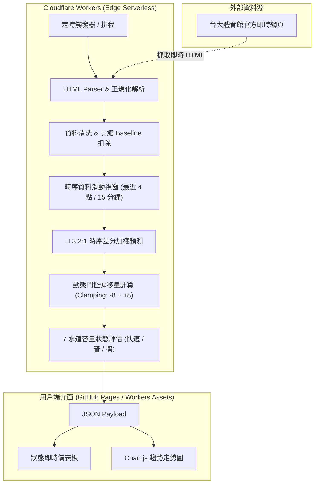

# 🏊 NTU PoolFlow · 台大泳池人流即時監控與智慧預測系統

> **一句話說明**：基於 7 水道物理容量建模、3:2:1 時序衰減預測演算法與 Cloudflare Workers 邊緣運算的台大泳池人流即時決策看板。

[](https://pool.8915ethan.workers.dev/)
[](https://github.com/8915ethan/ntu-pool/actions/workflows/ci.yml)
[](https://github.com/8915ethan/ntu-pool)
[](https://www.typescriptlang.org/)
[](https://vitest.dev/)
[](LICENSE)

---

## 📸 成果展示 (Live Demo & Preview)

- 🌐 **線上正式版**：[**https://pool.8915ethan.workers.dev/**](https://pool.8915ethan.workers.dev/)
- 📱 **介面特點**：響應式 RWD、深淺色自適應、即時容量儀表板、Chart.js 時序走勢圖，並支援「真實資料 (BETA)」與「情境模擬 (DEMO)」一鍵切換。

<p align="center">
  
</p>

---

## 🎯 專案背景與解決痛點

### 1. 痛點剖析：通勤準備延遲（Transit Delay）
台大官方網站僅提供當下現場單一數字，這會造成泳客嚴重的**決策落差**：
- 泳客出發前查看看板，顯示 30 人（綠燈舒適）決定前往。
- 出發、通勤、置物更衣至踏入泳池通常需 **15 ~ 20 分鐘**。
- 若正逢人潮湧入尖峰（每 5 分鐘增加 5~8 人），泳客抵達時現場已暴增至 45 人（紅燈擁擠）。

### 2. 解決方案
不只顯示「當下靜態人數」，而是引入**短期時間序列斜率加權預測**，在偵測到人流急湧時**提前動態調低警戒門檻（提早亮黃/紅燈）**，將使用者從出發到入池的時間差納入考量。

---

## 👤 個人角色與參與範圍

- **角色**：獨立開發者（人機協同開發）
- **🤖 AI 協作標記**：本專案採用 **AI 結對協作（AI Pair Programming）** 模式完成。由開發者主導問題定義、7 水道物理容量建模、時序預測架構設計與邊界防禦規劃，並與 AI 協同進行 TypeScript 模組實作、單元測試覆蓋與 CI/CD 自動化工作流調校。
- **負責範疇**：
  - **領域建模**：實地勘查 50m 標準池與水道配置，推導「7 水道容量基準（33 / 42 人）」。
  - **演算法研發**：設計「3:2:1 時序加權差分」與「開館 Baseline 淨人數校正」機制。
  - **全端實作**：以 TypeScript 撰寫容錯 HTML 爬蟲、狀態評估邏輯，並使用 Chart.js 構建前端視覺化。
  - **工程品質**：Vitest 自動化單元測試防護、GitHub Actions CI/CD Pipeline。
  - **雲端部署**：Cloudflare Workers Serverless 邊緣架構部署。

---

## ⚡ 核心功能與技術特色

| 功能模組 | 實作邏輯 | 效益 |
| :--- | :--- | :--- |
| **🏊 7 水道物理容量模型** | 快適 **33 人** / 擁擠 **42 人** | 拒絕憑空猜測，依 5 快速長泳道 + 2 慢速道 + 更衣緩衝區推導出承載上限。 |
| **🔮 3:2:1 時序加權差分** | 提取過去 15 分鐘加速度向量 | 越靠近當下權重越高，推估未來 20 分鐘抵達人數，動態偏移燈號門檻。 |
| **🎯 開館 Baseline 自動校正** | 開館準備期提前採樣 | 自動濾除救生員與常駐工作人員底數，還原水下真實「淨泳客」體感。 |
| **⏱️ 營業時段智慧守衛** | Asia/Taipei 時區運算 | 精準依平日 08:00~21:30 與週末時段管控，圖表自開館起跑，節省邊緣運算。 |

> 📖 **詳細數學推導與完整情境演繹**：[docs/predictive-crowd-offset.md](docs/predictive-crowd-offset.md)

---

## 🏗️ 系統架構與資料流程



---

## 💡 技術亮點與工程思維

### 1. 領域物理建模（Domain Modeling）
不採用憑感覺設定的固定百分比，而是依現場標準 50m 池的物理空間承載上限推導：
- **快適門檻（33 人）**：5 條快速長泳道（每道 3 人長泳不碰腳，共 15 人）+ 2 條慢速道（每道 4 人，共 8 人）+ 男女更衣淋浴緩衝區（各 5 人，共 10 人）= **33 人**。
- **擁擠警戒（42 人）**：快速道達 4 人飽和上限（20 人）+ 慢速道 5 人（10 人）+ 更衣緩衝區各 6 人（12 人）= **42 人**。

### 2. 時序差分預警（3:2:1 Predictive Offset）
為消弭出發至入池的 15~20 分鐘通勤落差，系統採集近 15 分鐘連續 4 個時序點（$T-15, T-10, T-5, T$），賦予線性時間衰減權重：
- **加權斜率預測**：賦予 $3 : 2 : 1$ 權重提取短期加速度向量，急湧時動態下修門檻（提早亮黃/紅燈預警），散場退潮時適度放寬。
- **阻尼調節與邊界保護**：引入 0.5 阻尼係數防止外推發散，並限制門檻偏移於 $[-8, +8]$ 人區間，避免單一團體入場產生突波噪訊誤判。

### 3. 開館 Baseline 自動校正
開館前 30 分鐘（平日 07:30 / 週末 08:30）啟動爬蟲採集首批底數，濾除在場就緒的救生員與早班清潔人員，確保看板呈現的是水下真正的「淨泳客」體驗數。

---

## 🛠️ 技術棧 (Tech Stack)

| 領域 | 技術選型 | 選用原因 |
| :--- | :--- | :--- |
| **語言** | TypeScript 5.5 | 全型別嚴格定義，避免時序資料數值與時間解析的隱蔽型別錯誤。 |
| **運算環境** | Cloudflare Workers | 零冷啟動、極低成本且全球邊緣節點加速。 |
| **前端視覺化**| Chart.js 4.4 / CSS Grid | 輕量化、零前端框架打包負擔，適合高頻更新的微型看板。 |
| **測試框架** | Vitest 3.0 | 執行極快，原生相容 ESM 與 TypeScript。 |
| **CI/CD** | GitHub Actions | 每次 Push 自動執行 `typecheck` 與單元測試矩陣。 |

---

## 💻 本機啟動與測試 (Quick Start)

### 1. 安裝與環境準備
```bash
git clone https://github.com/8915ethan/ntu-pool.git
cd ntu-pool
npm install
```

### 2. 執行型別檢查與自動化測試
```bash
# 執行型別檢查 + Vitest 單元測試
npm run check

# 單獨觀察測試
npm run test
```

### 3. 本機啟動前端看板
```bash
npx serve .
# 開啟瀏覽器訪問 http://localhost:3000
```

### 4. 執行爬蟲示範
```bash
npm run crawl:demo
```

---

## ⚖️ 遇到的挑戰與決策紀錄 (Decision Log & Trade-offs)

### Q1：官方網站沒有開放 API，且 DOM 結構可能隨時變更？
- **處置**：採用正則表達式非貪婪匹配核心數值節點，並在解析層實作 Fallback 與 Null 檢查；搭配 Vitest 針對破壞性 HTML 片段進行邊界測試，確保解析失敗時不會讓 Worker 崩潰。

### Q2：為什麼不直接用複雜的機器學習（如 LSTM / Prophet）？
- **決策**：在缺乏長期歷史資料與外部環境特徵（天氣、節慶）的初期，機器學習模型會面臨過擬合與黑箱不可解釋性。採用**「物理容量 + 差分線性加權」**具備三大優勢：
  1. 運算開銷微乎其微（能在 Edge Workers 上 $O(1)$ 即時完成）。
  2. 邏輯高度透明，便於由泳客反饋調校阻尼係數。
  3. 滿足 90% 的尖峰急湧預警需求。

### Q3：開館初期非零人數干擾？
- **處置**：開館時往往有救生員與清潔人員先行入場（約 2~4 人）。系統實作「開館首筆採樣扣除法」，將基礎底數扣除，確保呈現在儀表板的是真實的「水下泳客體驗人數」。

---

## 🚧 已知限制與後續 Roadmap

- [ ] **限制 1**：目前短期斜率預測僅看過去 15 分鐘，若遇到突發暴雨等不可抗力天氣，人潮可能斷崖式下跌，演算法反應有 15 分鐘滯後。
- [ ] **Roadmap 1（多特徵迴歸）**：整合氣象署即時降雨 API 與校園行事曆（期中/期末考週、寒暑假），建立中長期預測特徵。
- [ ] **Roadmap 2（推播通知）**：透過 Telegram Bot / LINE Notify 提供「人潮低於 25 人且持續空閒時」的主動推播提醒。
- [ ] **Roadmap 3（多場館抽象化）**：將 7 水道物理模型抽象化為通用介面，未來可擴展至台科大、台師大或各市立運動中心。

---

## 📄 授權條款 (License)

本專案採用 [MIT License](LICENSE) 條款開放原始碼。歡迎開源社群參考、改進或提交 PR！
