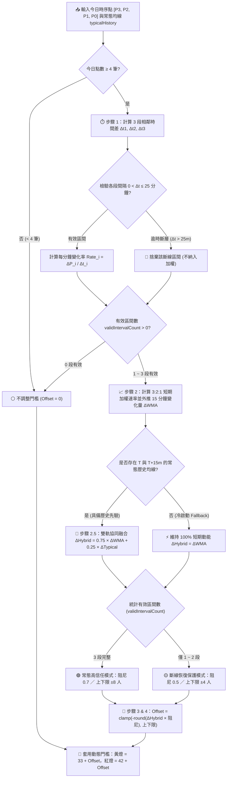

# 🔮 加權移動平均與常態歷史協同預測演算法機制
### Hybrid Weighted Moving Average (75% WMA + 25% Typical Slope) & Dynamic Threshold Adjustment

本文件深入解析 **台大體育館溫水游泳池監控系統（NTU PoolFlow 未游先知）** 所採用的「**75% 短期加權移動平均（WMA）＋ 25% 常態歷史均線斜率（Typical Slope）**」雙軌協同人潮預測演算法。

---

## 📌 為什麼需要動態預測？（痛點剖析）

在傳統的泳池或場館人數監控中，多數系統採用**固定靜態門檻**（例如：超過 42 人亮紅燈）。然而這會產生嚴重的**時間差決策盲點**：

> 🏃 **泳客的決策盲點**：  
> 泳客在**出發前**查看網站，看到目前人數舒適（例如 30 人綠燈）決定前往。從出發通勤、置物到更衣淋浴準備入池，通常約需 **15~20 分鐘**。  
> 若正逢人潮湧入尖峰（例如每 5 分鐘增加 5~8 人），等泳客抵達現場時，人數可能已暴增至 45 人以上（轉為擁擠紅燈），造成「出發前看似舒適、到場後卻極度擁擠」的決策落差。

為了解決這個問題，本系統結合**「過去 15 分鐘現場即時動能（75%）」**與**「過去 4 週同星期常態走勢斜率（25%）」**，在人潮急遽上升時**提前調低警戒門檻（提前亮黃燈/紅燈）**；反之在快速散場退潮時適度放寬門檻。

---

## ⏱️ 雙軌時間軸圖解架構 (Timeline Architecture)

系統每 5 分鐘從台大伺服器採集一次即時人數。演算法同時提取**「現場短期連續 4 個時序點（過去 15 分鐘視窗）」**與**「同星期常態歷史均線（未來 15 分鐘同期變化）」**，協同推估未來 15 分鐘的人流走向：

```text
 【軌道 A：75% 短期即時動能】歷史觀測視窗 (過去 15 分鐘)          未來預測窗口 (未來 15 分鐘)
├───────────┼───────────┼───────────┤ · · · · · · · · · · · · · · · · · · · · ┤
T-15m       T-10m       T-5m        T (當前)                                  T+15m
[ P3 ]      [ P2 ]      [ P1 ]      [ P0 ]                                 [ 抵達現場 ]
  │           │           │           │
  └── Rate3 ──┘           │           │
   (權重: 1)              │           │
              └── Rate2 ──┘           │
               (權重: 2)              │
                          └── Rate1 ──┘
                           (權重: 3)
  ────────────────────────────────────►
       短期 3:2:1 加權速率外推 (ΔWMA)  ──┐
                                         ├──► 75% ΔWMA + 25% ΔTypical ──► 動態調整燈號門檻 (Offset)
       過去 4 週同星期均線斜率 (ΔTyp)  ──┘
                                         ▲
                                         ├────────────────────────────────────┤
                                       Typical(T)                        Typical(T+15m)
                                       【軌道 B：25% 常態歷史同期斜率】 (未來 15 分鐘先驗趨勢)
```

### 時間軸上的節點定義：

| 時間標籤 | 相對於現在 | 變數代號 | 意義說明 |
| :--- | :--- | :--- | :--- |
| **T - 15m** | 15 分鐘前 | `P3` | 短期觀測視窗起點 |
| **T - 10m** | 10 分鐘前 | `P2` | 短期中繼點 A |
| **T - 5m** | 5 分鐘前 | `P1` | 短期中繼點 B |
| **T** | **當前當下** | `P0` / `Typical(T)` | 最新官方現場實測人數 ／ 過去 4 週同星期當下常態均線 |
| **T + 15m** | 未來 15 分鐘後 | `Typical(T+15m)` | 泳客決定出發後真正踏入泳池的預期時間 ／ 常態均線未來同期點 |

---

## 🔄 演算法完整決策流程圖 (Algorithm Flowchart)



---

## 📐 數學公式與計算步驟 (Mathematical Formula)

### 步驟 1：依據真實時間差計算區間變化率（Δt 時間差正規化）

為避免因網路延遲或偶發漏爬（例如時間間隔非固定 5 分鐘）造成數值失真，計算相鄰時序點每分鐘真實變化速率（人/分鐘），並過濾 `Δt > 25` 分鐘的斷線區間：

$$\text{Rate}_1 = \frac{P_0 - P_1}{\Delta t_1}, \quad \text{Rate}_2 = \frac{P_1 - P_2}{\Delta t_2}, \quad \text{Rate}_3 = \frac{P_2 - P_3}{\Delta t_3}$$

*(其中 `0 < Δt ≤ 25` 為相鄰兩筆紀錄的實際分鐘差)*

### 步驟 2：短期加權移動平均（線性加權 3 : 2 : 1）

越靠近當下的變化，對未來的影響力越大，因此對有效區間的變化速率進行**加權移動平均（Weighted Moving Average, WMA）**，並外推未來 15 分鐘短期變化量 `ΔWMA`：

$$\text{Weighted Rate} = \frac{3 \times \text{Rate}_1 + 2 \times \text{Rate}_2 + 1 \times \text{Rate}_3}{6}$$

$$\Delta_{\text{WMA}} = \text{Weighted Rate} \times 15$$

> 💡 **為什麼短期使用 3:2:1 加權移動平均？**  
> 若只看最近一筆（`1:0:0` 單段斜率），容易受到單次刷卡突波干擾；若採等權重（`1:1:1` SMA），對剛發生的尖峰湧入反應較慢。三段線性加權（`3:2:1`）能兼顧轉折靈敏度與抗噪平滑性。

### 步驟 2.5：融合常態歷史均線斜率（75% 短期 WMA + 25% 常態歷史斜率）

單靠過去 15 分鐘的短期斜率缺乏「時間背景先驗（Time-of-Day Prior）」，容易在離峰單次進場時過度反應，或在晚間尖峰短暫換氣時誤判為散場。因此系統引入後端預先聚合的**過去 4 週同星期常態歷史曲線（`typicalHistory`）**，計算當下 `T` 至未來 `T + 15m` 的常態同期人數變化量：

$$\Delta_{\text{Typical}} = \text{Typical}(T + 15\text{m}) - \text{Typical}(T)$$

接著以 **75% : 25%（3 : 1）** 權重進行雙軌協同融合：

$$\Delta_{\text{Hybrid}} = 0.75 \times \Delta_{\text{WMA}} + 0.25 \times \Delta_{\text{Typical}}$$

*(註：若為冷啟動或該時段無對應之 `typicalHistory`，系統自動平滑降級為 `ΔHybrid = ΔWMA`)*

### 步驟 3：套用阻尼係數計算門檻偏移量

將協同預測之未來 15 分鐘變化量乘上阻尼係數（常態為 `0.7`），換算出門檻偏移量 `Offset`：

$$\text{Offset} = -\text{round}(\Delta_{\text{Hybrid}} \times \text{damping})$$

*(註：負值代表人潮湧入中、門檻提前下修預警；正值代表散場退潮中、門檻適度上修放寬)*

### 步驟 4：爬蟲中斷防護與自適應安全上下限

為防止爬蟲斷線恢復瞬間或極端突波造成誤判，系統依有效區間數動態切換防護等級：

1. **大間隔斷層截斷**：相鄰時序點若 `Δt > 25` 分鐘，視為無效斷層，不納入加權計算。
2. **常態模式（3 段完整）**：信任度 100%，採用阻尼 `0.7`，動態調整上限為 **±8 人**。
3. **斷線恢復過渡期（僅 1~2 段有效）**：採取保守防護，阻尼降至 `0.5`，調整上限嚴格限制在 **±4 人**。
4. **完全無有效區間**：門檻不調整（`Offset = 0`）。

$$\text{Final Offset} = \max(-\text{clampLimit}, \min(\text{clampLimit}, \text{Offset}))$$

---

## 🔬 歷史資料時序分割驗證與 75% : 25% 係數推導

為確保雙軌權重（`w1 = 0.75, w2 = 0.25`）具備嚴謹統計基礎且無未來資料洩漏（Data Leakage），本系統使用實際採集的 **2,137 筆歷史時序紀錄（1,847 個有效預測視窗）** 進行**時序前後切分驗證（Walk-Forward Validation）**：

1. **歷史先驗基底期（Warm-up Prior，第 1 週 `10/26 ~ 11/01`）**：建立過去同星期幾的 `typicalHistory`，不參與權重擬合。
2. **訓練集（Train Set，`11/03 ~ 11/05` 共 473 筆）**：擬合短期動能 `ΔWMA` 與常態斜率 `ΔTypical` 的最佳組合係數。
3. **樣本外測試集（Out-of-Sample Test Set，`11/06 ~ 11/08` 共 385 筆）**：在未見過的未來資料上驗證泛化能力。

### 雙模型權重決定之三種方法對照：

* **方法 1（最小平方法無截距回歸 OLS）**：在訓練集對真實 15 分鐘變化量擬合 `ΔY = β1 × ΔWMA + β2 × ΔTypical`，求得理論正規化權重比為 **69.1% : 30.9%**（活躍變動時段為 **69.7% : 30.3%**）。
* **方法 2（Bates-Granger 誤差變異數倒數加權）**：依訓練集兩模型誤差變異數（`RMSE1 = 5.98, RMSE2 = 6.65`）與共變異數求解，得 **62.3% : 37.7%**。
* **方法 3（紅燈預警 F1-Score 決策最佳化）**：針對核心痛點「尖峰湧入提前亮紅燈」進行網格驗證，**`75% : 25%`（`3 : 1`）** 在完全不損失突發團課攔截率的前提下消除假警報，取得最高 **F1-Score**：

| 權重配比 (w1 WMA : w2 Typical) | 訓練集 MAE / RMSE | **樣本外測試集 MAE / RMSE** | 紅燈預警準確率 (Precision) | 紅燈退潮放寬準確率 | **紅燈預警 F1-Score** |
| :--- | :---: | :---: | :---: | :---: | :---: |
| **`100% : 0%`（純短期 WMA）** | 3.60 / 5.49 | 3.66 / 6.36 | 71.4% | 47.4% | 58.3% |
| **`85% : 15%`** | 3.46 / 5.36 | 3.42 / 5.85 | 75.0% | 52.9% | 60.9% |
| 🏆 **`75% : 25%`（系統採用 `3 : 1`）** | **3.39 / 5.33** | **3.28 / 5.54** | **90.0%** | **66.7%** | **66.7% (最高峰)** |
| **`70% : 30%`（OLS 理論解）** | 3.37 / 5.31 | 3.19 / 5.41 | 85.7% | 66.7% | 60.0% |
| **`50% : 50%`** | 3.33 / 5.31 | 3.02 / 5.17 | 66.7% | 64.7% | 54.5% |

---

## 🏊 7 水道物理容量門檻模型

本系統的燈號門檻依據**台大綜合體育館溫水游泳池的 7 水道空間配置**與更衣緩衝區推導：

- **水道配置**：全館共 7 條 50 公尺標準水道（中間 5 個快速長泳道 + 兩側 2 個慢速道/教學道）
- **快適上限（綠-黃門檻）：33 人**
  - 5 快速長泳道（每道 3 人，共 15 人）+ 2 慢速道（每道 4 人，共 8 人）+ 男女更衣與場內緩衝區（各 5 人，共 10 人）= **33 人**
  - 現場人數 < 33 人：**🟢 舒適**
- **擁擠警戒（黃-紅門檻）：42 人**
  - 5 快速長泳道（每道 4 人達上限，共 20 人）+ 2 慢速道（每道 5 人，共 10 人）+ 男女更衣與場內緩衝區（各 6 人，共 12 人）= **42 人**
  - 33 人 ≤ 現場人數 < 42 人：**🟡 中等**
  - 現場人數 ≥ 42 人：**🔴 擁擠**

---

## 🚦 動態門檻調整與真實情境驗算

在考慮人潮增減趨勢後，即時燈號門檻調整為：
- **即時黃燈門檻** = `33 + Offset`
- **即時紅燈門檻** = `42 + Offset`

### 情境 A：下班尖峰急遽湧入（2026-11-03 週二 18:00 實測案例）
* **現場走勢**：17:45 ~ 18:00 現場人數由 `30 → 34 → 31 → 41 人` 快速攀升，且週二晚間 18:00~18:15 常態歷史均線亦處於尖峰上升段。
* **演算法輸出**：推估未來 15 分鐘將大幅增加，計算偏移量達上限 **`Offset = -8 人`**，動態紅燈門檻提前降為 **34 人**（原為 42 人）。
* **決策結果**：當前 41 人已超過 34 人動態紅燈門檻，**系統在 18:00 提前亮紅燈**！15 分鐘後（18:15）現場實際暴增至 **62 人**，成功避免泳客通勤抵達後踩雷。

### 情境 B：晚間快速散場退潮（2026-11-03 週二 19:45 實測案例）
* **現場走勢**：19:30 ~ 19:45 現場人數由 `61 → 58 → 53 → 47 人` 快速遞減，且常態歷史均線於 19:45~20:00 同步呈現散場下滑。
* **演算法輸出**：計算偏移量達 **`Offset = +8 人`**，動態紅燈門檻上修放寬為 **50 人**。
* **決策結果**：當前 47 人小於 50 人，**提前解除紅燈轉為黃燈**；15 分鐘後（20:00）現場實際降至 **36 人**，讓想趁晚間空檔入場的泳客不必乾等。

---

## 💻 原始碼實作對照 (Source Code Reference)

此機制已在專案中完整實作並經過自動化單元測試：

- **核心函式**：[src/utils.ts](../src/utils.ts) 內的 `calculatePredictiveOffset(todayPoints, typicalHistory)`
- **前端視覺應用**：[index.html](../index.html) 內的動態燈號邏輯
- **單元測試**：[test/utils.test.ts](../test/utils.test.ts) 中的單元測試套件
